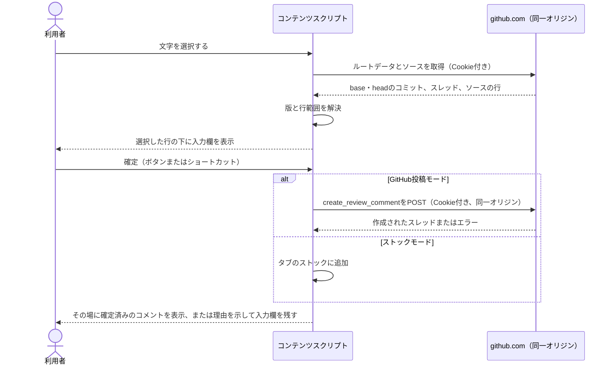
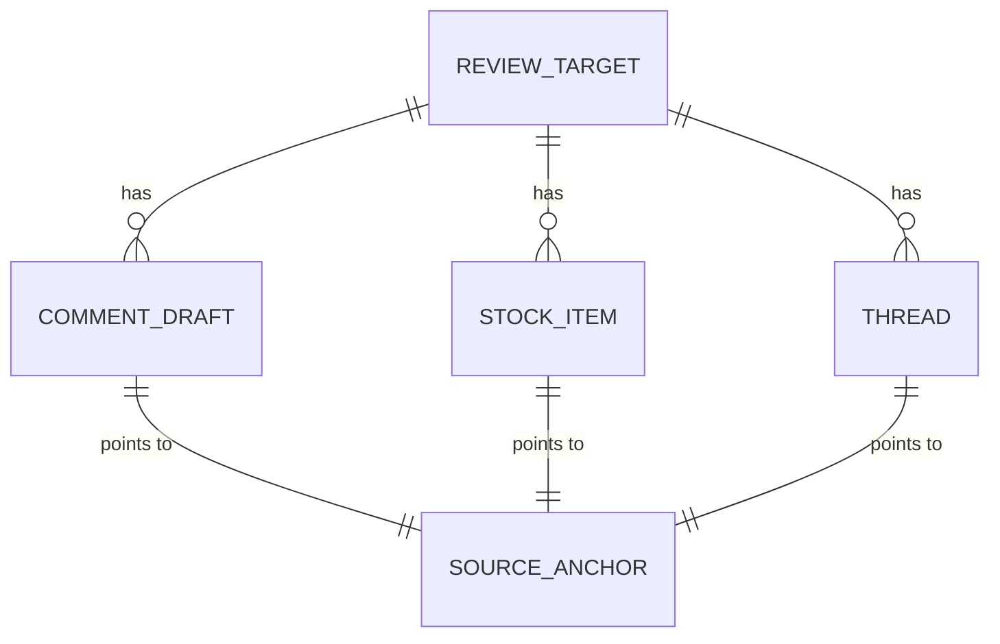

# レンダリングしたMarkdownへのコメントの設計

[English](design.md)

## このドキュメントについて

[MarginkのProduct](../../product.ja.md)のうち、[レンダリングしたMarkdownへのコメントのRequirements](requirements.ja.md)をブラウザ拡張でどう実現するかを説明します。
Requirementsが Design に委ねた二つの問い、つまりログイン中のGitHubセッションで行コメントを投稿・閲覧する方法と、レンダリングした文章を推測せずにGitHubのソース位置へ対応付ける方法を決めます。

### 対象読者

Margink拡張を実装・変更する人とエージェント。

### 前提知識

上記のRequirements、Manifest V3のブラウザ拡張の基本、GitHubのプルリクエストでMarkdownファイルがレンダリングした差分（rich diff）として表示される仕組みを理解していることを前提にします。
レンダリングした文章の差分についてのGitHubの説明は[Working with non-code files](https://docs.github.com/en/repositories/working-with-files/using-files/working-with-non-code-files)にあります。

### このドキュメントで扱わないこと

ストアへの公開、Firefoxの正式対応、その他のブラウザはProductで決めます。
返信、編集、削除、スレッドの解決は、Requirementsのとおり GitHub の標準UIで行います。

## 実装方針

### 成果物

成果物は、[WXT](https://wxt.dev/get-started/introduction)とTypeScriptで作る一つのManifest V3拡張です。
WXTは同じソースからChrome版とFirefox版を作れるため、リリースを約束せずにProductのFirefox展開の選択肢を残せます。
拡張は次の三つで構成します。

- **コンテンツスクリプト**: `github.com`のプルリクエストのページで動き、選択、コメント入力欄、通信、スレッド表示など、ページに関わる処理をすべて担います。
- **バックグラウンドのService Worker**: タブごとのストックを管理します。タブの識別子とタブを閉じたことを知れるのはこの部分だけで、ページから触れる保存場所にストックを置かないためです。
- **オプションページ**: モードと確定用ショートカットを編集します。

文字の正規化、位置の解決、リクエスト本文の組み立て、ショートカットの判定、ストックの整形など、DOMを必要としない処理は通常のモジュールに分け、ブラウザなしで単体テストできるようにします。

### 主な流れ

プルリクエストのファイル表示が読み込まれると、コンテンツスクリプトはURLからプルリクエストを特定し、ページのルートデータ（[APIとインターフェース](#apiとインターフェース)で説明）を取得して、base・headのコミットと変更されたファイルを把握します。
GitHubはファイルを遅れて読み込み、ページ全体を再読み込みせずに画面を切り替えるため、レンダリングされたMarkdownファイルの出現を監視します。

利用者が一つのレンダリングしたMarkdownファイルの中で文字を選択して入力を始めると、打った文字が入った状態で、選択を含む行の直下にインラインの入力欄が開き、コンテンツスクリプトは選択範囲をソースの位置に解決します。
入力欄には、確定前に対象（ファイル、版、行範囲）と投稿先を表示します。

確定時に本文が空または空白だけの場合は、その場で受け付けません。
GitHub投稿モードでは一件のレビューコメントを公開し、ストックモードでは一件のストック項目を追加します。
成功すると、入力欄は同じ場所で確定済みのコメント表示に変わり、読み返したりGitHubで開いたりできます。
失敗した場合は、本文と対象を残したまま入力欄を開いておき、理由を表示します。

### 操作のデザイン

入力欄は、プロダクトの決定者が示した参考画面と画面収録に合わせます。参考画面は、レンダリングしたMarkdownにインラインでコメントし、Command+Enterで送信できるレビューツールです。
画面収録では、利用者が単語をダブルクリックしてすぐに文字を打つと、その行の下にコメントが現れます。単語には下線が残り、次の単語にも同じ操作でコメントします。
その特徴は軽さと読む流れを止めないことなので、入力欄はフォームではなく文書の一部として設計します。

- **始め方。** コメントできる文字を選び終えたとき（マウスのボタンを離したとき、またはキーボードで選択を広げてShiftを離したとき）、Marginkは選択の下に入力欄を見えない状態で用意します。場所は取らず、その入力欄にフォーカスを移します。
  キーを押す前から入力欄にフォーカスがあるため、最初のキーは、IMEの最初のキーも含めて入力欄に入り、GitHubの1キーのショートカットには届きません。
  変換の開始か最初の入力で入力欄をその場に表示し、そのときに初めてソース位置を解決します。
  何も入力していない間は、選択はページの選択色のまま表示し、コピーすると選択した文字がコピーされます。矢印キー、Page Up・Page Down、Home、End、Tab、Space、またはコピー以外のCommand・Controlの組み合わせを押すと、見えない入力欄を閉じて選択を戻すため、ページのキー操作はそのまま使えます。
  文字を選択せずにレンダリングしたブロックをクリックした場合も、そのブロック全体に対して同じ見えない入力欄を用意します。置き場所は追加ボタンと同じくブロックの直後です。読んでいる場所をクリックしてそのまま打てば、コメントを始められます。
  入力を始めるまで画面には何も表示しません。リンク、ボタン、折りたたみの見出し、フォームの部品をクリックした場合は始めません。何も入力していない間はSpaceも移動のキーとして扱い、ページのスクロールに使えるようにします。
  見えない入力欄は絶対配置にするため、用意しても文章は動きません。移動のキーで閉じるときは、そのkeydownの間に入力欄からフォーカスを外すため、ページがいつも通りにキーを処理します。
  空の入力欄はEscか外側のクリックで閉じます。文字が入っている入力欄は、新しい選択で置き換えません。
- **追加ボタン。** レンダリングしたブロック（段落、見出し、リストの項目、表の行、コードブロック、定義リストの項目）にポインタを重ねると、本文のすぐ左（レンダリングしたMarkdown本体の余白の端から6px左、ファイルの内側）、そのブロックの1行目の高さに、22pxの青い「+」ボタンを表示します。GitHubがソース表示で行に重ねたときに出す「+」に合わせた見た目です。
  クリックすると、入力欄をブロックの直後（リストの項目では入れ子のリストの前、表の行では表の後）に表示してフォーカスし、ブロック全体をすぐにソース行へ解決します。
  始め方は両方使えます。言葉を選択するとその言葉に、追加ボタンを使うとブロック全体にコメントします。ブロックは、GitHubのソース表示の行にあたるものです。
  ポインタがブロックから離れてもボタンは少しの間残るため、余白を横切ってボタンに届きます。Margink自身のUIの上と、レンダリングしたファイルの外では隠します。
- **置き場所。** 選択から始めた場合、選択の終わりを含む表示上の行の下に入力欄を挿入し、レンダリングした段落をそこで分けて、段落の続きを入力欄の下に表示します。
  その位置がリンクなどのインライン要素の中にある場合は、その要素の後ろに置きます。コードブロックと表の中、またはブロックの最後の行では、ブロックの後ろに置きます。
- **文章の強調。** 入力欄を表示したあと、選択した文字に入力欄のアクセント色で2pxの下線を引きます。CSS Custom Highlight APIで描くため、GitHubのDOMを包んだりスタイルを変えたりしません。
- **入力欄。** 1pxの枠線、わずかに明るい背景、左に3pxのアクセント色の線を持つ、控えめなカードです。先頭に利用者のアバターを置き、枠のない入力欄は1行から内容に合わせて伸びます。
  書く場所の中にはラベルやボタンを置きません。下の小さな薄い行に対象を表示し、右側の薄い文字の操作に投稿先とショートカット（例:「Post to GitHub ⌘Enter」）を表示します。これが画面上の確定操作も兼ねます。
- **確定済みのコメント。** 投稿後は同じカードがアバターと本文を残し、画面収録の確定したコメントと同じようにアクセント色の線を消して、GitHub上のコメントへリンクします。文章には、アクセント色の薄い下線を残します。
- **キー操作。** 設定した組み合わせで確定し、Enterで改行し、Escで取り消します。IMEの変換は常に優先します。入力欄のキー操作はGitHubのページのショートカットに届きません。

アクセント色は紫（#8250df、暗い背景では#ab7aca）です。参考画面に合わせつつ、GitHubのライトとダークのテーマで読めるようにしています。
画面収録では、入力中のコメントが、ファイルと行、選択した語を強調したソースの行、コメント本文を並べた一覧にも即時に反映されます。この一覧はストックのパネルに当たり、その変更で扱います。
カードは、ページがPrimerの色の変数を定義していればそれを使います。
inline-block要素にしているため、変更された段落の中に置いても、GitHubの追加・削除の下線がカードに広がりません。

### 選択範囲からソース位置への解決

レンダリングした差分には行番号の属性がないため、位置はソースの文章から求めます。
解決は三段階で行い、どの段階でも答えが一つに決まらない場合は推測せずに失敗とします。

1. **版を決める。** GitHubの削除を表すマークアップ（`del`要素と削除ブロックのクラス）の中の文字はbaseの版、それ以外はheadの版に属するとします。
   変更のない文章はheadの版を使います。GitHubは差分に表示されている行への投稿を受け付けます。
   削除された文字と追加された文字の両方を含む選択は、版が混在しているとして受け付けません。
2. **ソースの中から文章を探す。** 決めた版のソースを取得し、Markdownの記法を取り除いて空白をまとめた正規化済みの文字列を作ります。正規化後の各文字が元のどの行にあったかの対応も保ちます。
   選択した文字も同じ方法で正規化します。
3. **一致を一つに決める。** 選択した文字が正規化したソースに一度だけ現れる場合は、その箇所を対象にします。
   複数回現れる場合は、同じ版のレンダリングした文字の中で選択が何番目の出現かを数え、ソースでも同じ番目の出現を対象にします。
   これはレンダリング側とソース側の出現回数が等しい場合だけ有効で、異なる場合は解決に失敗します。

結果は、一つの版における開始行と終了行です。
一行に収まる範囲は単一行コメント、それより長い範囲は複数行コメントにします。
Mermaidの図や画像など、レンダリングした画面にソースと対応する文字がないものは対象にしません。

解決に失敗した場合は、「この文章は複数回現れるため、どれを選択したか判断できません」のように理由を示して入力欄を残し、利用者が選び直すか、明示的にストックモードへ切り替えられるようにします。

### 投稿とストック

GitHub投稿モードでは、保留中のレビューにせず、すぐに公開します。
コメント本文は、選択した文字をMarkdownの引用として先頭に置き、空行を挟んで利用者のコメントを続けます。GitHubで読む人が、行のどの言葉を指すのか分かるようにするためです。
追加ボタンから始めたコメントはブロック全体についてのもので、対象の行はGitHubがコメントの上に表示するため、本文には引用を付けず利用者のコメントだけにします。
ブロックは、その文字をすべて選択した場合と同じように解決します。ただし版の決め方は異なり、文字がすべて削除されたブロックは変更前の版、それ以外のブロックは変更後の版を使い、削除された言葉を除きます。
通信中は入力欄の確定を無効にし、ショートカットやクリックを繰り返しても二件目の投稿を始めません。
応答は、成功、既知の失敗（ログイン切れ、権限不足、対象の消失、位置の拒否）、不明（通信エラーやタイムアウト）に分けます。不明の場合は、投稿されている可能性があることを示してプルリクエストへのリンクを出し、自動では再送しません。再送するとコメントが重複するおそれがあるためです。

ストックモードでは、確定してもGitHubに通信しません。
モードを切り替えても、既存のストックを投稿・削除しません。

### ストックのコピー

ストックのパネルは、現在のタブで開いているプルリクエストの項目を一覧にし、Markdownのテキストとしてコピーします。

```markdown
## Review comments for owner/repo#123

### docs/guide.md (head, lines 12–13)

> selected passage

comment body
```

コピーはクリック操作の処理の中でClipboard APIを使います。
例外が起きた場合は、コピーに失敗したことを表示し、ストックを残します。

### 既存のスレッドの表示

コンテンツスクリプトは、コミットを知るために読み込むルートデータから、レビューのスレッドも読み取ります。
各スレッドには版と行範囲があり、スレッドの終了行を含むソース範囲を持つレンダリングしたブロックを探して、そこに印を表示します。
印を開くと、投稿者、本文、返信、解決済み・古い版の状態、GitHub上のスレッドへのリンクを表示します。
行を特定できないスレッドは、古い版のものも含め、推測したブロックに結び付けずに、ファイルごとの「位置を特定できないスレッド」欄に表示します。
取得に失敗した場合は、再試行の操作とともにエラーとして表示し、「コメントがない」状態と区別します。

### ショートカット

入力欄は自身で`keydown`を処理して伝播を止めるため、入力欄で押したキーはGitHubのドキュメント全体のショートカットに届きません。
最初のキーの間にフォーカスを移すのではなく、最初のキーより前にフォーカスしておくことで、IMEの入力が崩れません。ページ側で最初のキーを受け取ったIMEは、フォーカスが移る前にその文字をそのまま確定してしまうためです。
`event.isComposing`がtrueの間（または古い形式のキーコード229が報告された場合）は何もしないため、EnterはIMEの変換確定だけに使われます。
設定した確定用の組み合わせは、確定ボタンと同じ処理を実行します。
既定はmacOSでCommand+Enter、それ以外でControl+Enterで、Enter単独は改行です。
Enter単独を確定に選んだ場合はShift+Enterで改行し、それ以外を選んだ場合はEnter単独を改行に残します。
オプションページでは、改行する手段がなくなる組み合わせを受け付けません。
キー処理はMargink自身の入力欄だけに付けるため、GitHubの入力欄には影響しません。

## アーキテクチャ・シーケンス図



バックグラウンドのService Workerはこの図に含めていません。ストックモードでの追加は、[内部のメッセージ](#内部のメッセージ)で説明するとおりService Workerを経由します。

## データモデル・ER図



- **ReviewTarget**: ホスト、オーナー、リポジトリ、プルリクエスト番号、baseのコミット、headのコミットを持ちます。
- **SourceAnchor**: ファイルのパス、版（`base`または`head`）、開始行と終了行、その版のコミット、選択した文字を持ちます。
- **CommentDraft**: 本文、アンカー、モード、状態（`editing`、`sending`、GitHubのURL付きの`published`、理由付きの`failed`、`unknown`）を持ちます。
- **StockItem**: アンカー、本文、作成時刻を持ちます。
- **Thread**: GitHubのスレッド識別子、求められる場合はアンカー、コメント（投稿者、本文のHTML、時刻、URL）、解決済み・古い版のフラグを持ちます。
- **Settings**: モードと確定用の組み合わせを持ちます。

## APIとインターフェース

### 利用者向けのインターフェース

ページには、インラインの入力欄、その場に残る確定済みのコメント、文章の下線、モードの切り替えとストック一覧を持つ小さなパネルを表示します。
モードの切り替えには、ストックがタブを閉じるまでの一時的な保存であることを表示します。
オプションページでは、確定用の組み合わせを編集し、既定値に戻せます。

### コンテンツスクリプトが使うGitHubのエンドポイント

すべてのリクエストは、コンテンツスクリプトから`https://github.com`へ、ページのCookie、`X-Requested-With: XMLHttpRequest`と`GitHub-Verified-Fetch: true`のヘッダー、書き込みで必要な場合はページの`csrf-token`のmeta要素から読んだCSRFトークンを付けて送ります。
これらはGitHub自身のプルリクエストUIが使うエンドポイントで、GitHubの公開APIの一部ではありません。

- **ルートデータ**: `GET /{owner}/{repo}/pull/{number}/changes`（または`/files`）に`Accept: application/json`を付けると、base・headのコミット、ファイルの概要、レビューのスレッドが返ります。
- **ソースの文章**: `GET /{owner}/{repo}/raw/{commit}/{path}`はファイルの文章を返します。GitHubのraw用ホストへリダイレクトされることがあります。
  その応答を読めない場合は、`GET /{owner}/{repo}/blob/{commit}/{path}`がファイルのページを返し、その埋め込みデータにソースの行が含まれます。
  GitHubは過去にこの位置を変えているため、固定の場所に頼らず、埋め込みデータの中からソースの行を探します。
- **レビューコメントの作成**: `POST /{owner}/{repo}/pull/{number}/page_data/create_review_comment`に、base・headのコミット、パス、版、行または行範囲、本文を送ります。
  200または201の応答には、URLを含む作成されたスレッドが入ります。

各エンドポイントは、応答の形を検証する一つのモジュールで包みます。
想定しない形の応答は、「GitHubのページが変わったため、ここには投稿できません」と表示し、成功とは扱いません。

### 内部のメッセージ

コンテンツスクリプトは、バックグラウンドのService Workerへのメッセージ（`stock:list`、`stock:add`、`stock:clear`）を通してだけストックを読み書きします。
Service Workerは、送信元のタブの識別子を使った`stock:{tabId}`をキーとして`chrome.storage.session`に保存し、タブが閉じられたときにそのキーを削除します。

## 外部サービス連携

外部サービスはGitHubだけです。
拡張は公開されていないページ用のエンドポイントに依存しており、GitHubは予告なくそれを変更できます。
Requirementsが別の認証情報を禁じているため、別のトークンを使う方式ではなくこちらを選びました。
GitHubのページが変わっても、解析と通信のモジュールだけを直せば済むように分離します。

同じエンドポイントを使う類似の拡張、たとえば[rich-diff-comments](https://github.com/chienyuanchang/rich-diff-comments)は、観測したリクエストの形とエラーを文書化しています。これを出発点にしますが、リリース前にすべての形を実際のプルリクエストで確かめ直します。
GitHubは位置を受け付けられない場合に`422`を返します。Marginkはこれを「GitHubはこの行へのコメントを受け付けません」と表示し、コメントを別の場所へ移しません。

## データの取り扱い

- **ルートデータとソースの文章**は必要なときに取得し、現在のページのメモリにだけ保持します。
- **ストック**は`chrome.storage.session`に、タブの識別子を含むキーで保存します。これにより、タブ内の再読み込みや移動では残り、タブごとに分かれ、新しいタブや復元したタブ（新しい識別子を受け取る）では空から始まり、タブを閉じるかブラウザを終了すると削除されます。
- **設定**は`chrome.storage.local`に保存し、「既定に戻す」で初期化します。
- **入力途中の内容**はメモリにだけ保持し、ページを再読み込みすると未送信の内容は失われます。

GitHub以外にはデータを送りません。GitHubへ送るのも、GitHub投稿モードで利用者が確定したときと、拡張が読む必要のあるページを開いたときだけです。

## 認証・認可の留意事項

Marginkは独自の認証情報を持ちません。
コンテンツスクリプトが`github.com`上で動くため、リクエストにはブラウザのGitHubセッションのCookieが付き、GitHubはリクエストごとにログイン中のアカウントのリポジトリへのアクセス権とコメント権限を適用します。
ログアウトしている場合や権限がない場合は、GitHubのエラーを表示し、入力内容を残します。

## セキュリティ上の考慮事項

拡張のホスト権限は`https://github.com/*`に限ります。
Cookieやトークンを読み取り・コピー・保存しません。CSRFトークンはリクエスト時にページから読み、保存しません。
コメントとスレッドの本文は、GitHubが無害化した`bodyHTML`かテキストとして表示し、コメントの文字列からHTMLを組み立てません。
挿入するUIはShadow Rootの中に置き、ページのスクリプトやスタイルの影響を受けないようにします。取得したページのコードは実行しません。
すべてのリクエストには現在のURLのオーナー、リポジトリ、プルリクエスト番号を使うため、別のプルリクエストへコメントが送られることはありません。

## デプロイ時の留意事項

なし。

## 検討した代替案

### GitHubのOAuthと公開REST API

公開されているREST APIは安定し仕様も明確ですが、OAuth Appの登録、サインインの手順、トークンの保存が必要です。
Requirementsが別の認証情報を禁じているため、決定者はログイン中のセッションを使う方式を選びました。

### GitHub標準のソース表示のコメント欄を自動操作する

ファイルをソース表示に切り替え、標準のコメント欄を開いて送信すれば、GitHubのUIだけで済みます。
しかし、DOMが変わるたびに壊れ、コメントのたびにレンダリング表示から離れ、動作も遅いため、選びませんでした。

### Markdownを手元でレンダリングしてソース位置を得る

markdown-itのような手元のレンダラーはソースの行を返しますが、出力がGitHubのレンダリング（拡張記法、絵文字、無害化）と異なるため、レンダリングしたDOMと確実には照合できません。

### 一致しない場合に近くのブロックへ寄せる

ほかの拡張では、文章の照合に失敗したとき、直前に一致した行を使います。
Requirementsが推測した位置への投稿を禁じているため、Marginkは失敗を報告します。

## 未決事項

- GitHubのページ用エンドポイントの応答の形は、リリース前に実際のプルリクエストで確かめ直す必要があります。ログインしたアカウントでの手動テストで確認し、実装者が担当します。
- Firefox版はビルドしますが、ブラウザ対応についてのProductの決定までリリースしません。
