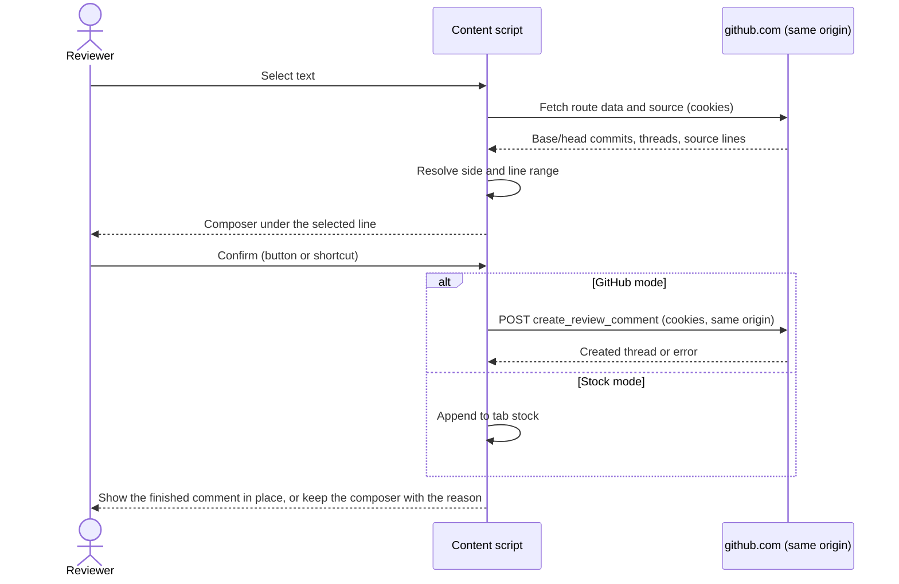
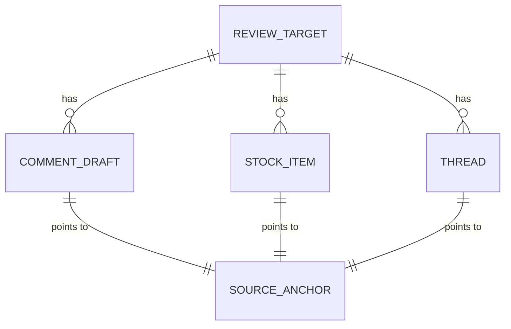

# Comments on rendered Markdown design

[日本語](design.ja.md)

## About this document

This document explains how the browser extension implements the [Comments on rendered Markdown Requirements](requirements.md) for the [Margink Product](../../product.md).
It settles the two questions the Requirements left to Design: how to publish and read line comments through the reviewer's existing GitHub sign-in, and how to map rendered text to a GitHub source location without guessing.

### Audience

People and agents implementing or changing the Margink extension.

### Prerequisites

Readers should know the Requirements above, the basics of Manifest V3 browser extensions, and how a GitHub pull request shows a Markdown file as a rendered ("rich") diff.
GitHub's own description of rendered prose diffs is in [Working with non-code files](https://docs.github.com/en/repositories/working-with-files/using-files/working-with-non-code-files).

### Outside this document

Store publication, Firefox release support, and other browsers are Product decisions.
Replies, edits, deletion, and resolving threads stay in GitHub's standard UI, as the Requirements state.

## Implementation approach

### Deliverables

The deliverable is one Manifest V3 extension built with [WXT](https://wxt.dev/get-started/introduction) and TypeScript.
WXT builds Chrome and Firefox packages from the same source, which keeps the Product's Firefox option open without committing to a release.
The extension has three parts:

- A **content script** on `github.com` pull request pages. It owns everything that touches the page: selection, the comment box, network requests, and thread display.
- A **background service worker**. It owns the per-tab stock, because only it knows tab identifiers and tab closing, and it keeps the stock away from page-reachable storage.
- An **options page**. It edits the mode and the confirm shortcut.

Logic that does not need the DOM (text normalization, location resolution, request bodies, shortcut matching, stock formatting) lives in plain modules so unit tests can run it without a browser.

### Main flow

When a pull request's file view loads, the content script reads the pull request coordinates from the URL and fetches the page's route data (described under [APIs and interfaces](#apis-and-interfaces)) to learn the base and head commits and the changed files.
It watches the page for rendered Markdown files, because GitHub loads files lazily and navigates without full page loads.

When the reviewer selects text inside one rendered Markdown file and starts typing, the inline composer opens directly beneath the line that holds the selection with the typed text in it, and the content script resolves the selection to a source location.
The composer shows the target (file, side, and line range) and the destination before the reviewer confirms.

On confirmation, an empty or whitespace-only body is rejected in place.
In GitHub mode the content script publishes one review comment, and in stock mode it adds one stock item.
After success, the composer turns into the finished comment in the same place, so the reviewer can read it again and open it on GitHub.
After failure, the composer stays open with the body and target, and shows the reason.

### Interaction design

The composer follows a reference screen and screen recording the product owner provided: a review tool that lets a reviewer comment inline on rendered Markdown and send with Command+Enter.
In the recording, the reviewer double-clicks a word, types immediately, and the comment appears under that line; the word keeps an underline, and the next word is commented on the same way.
Its qualities are lightness and staying in the reading flow, so the composer is designed as part of the document rather than as a form.

- **Start.** When the reviewer finishes selecting commentable text (mouse button released, or Shift released after extending the selection with the keyboard), Margink prepares the composer under the selection without showing it: it takes no space, and its text area receives focus.
  Because the text area already has focus before any key is pressed, the first key, including the first key of IME input, goes to the text area, and GitHub's single-key shortcuts never see it.
  Starting composition or the first input reveals the composer in place, and only then does Margink resolve the source location.
  While nothing is typed, the selection stays highlighted with the page's selection color, copying copies the selected passage, and navigation keys (arrows, Page Up and Down, Home, End, Tab) or shortcuts with Command or Control other than copy close the hidden composer and restore the selection, so the page's own keys keep working.
  An empty composer closes on Escape or on a click elsewhere. A composer that already holds text is not replaced by a new selection.
- **Add button.** Hovering a rendered block (paragraph, heading, list item, table row, code block, or definition) shows a 22px blue "+" button in the file's left margin, level with the block's first line, in the style of the "+" GitHub shows beside a hovered line in a source diff.
  Clicking it opens the composer, visible and focused, right after the block (inside a list item before its nested list, and after the table for a row), and resolves the whole block to its source lines at once.
  Both ways of starting stay available: selecting words comments on those words, and the add button comments on the whole block, the rendered counterpart of a line in GitHub's own diff.
  The button stays briefly when the pointer leaves the block, so it can be reached across the margin, and it hides over Margink's own UI and outside rendered files.
- **Placement.** For a selection, the composer is inserted under the visual line that contains the end of the selection, splitting the rendered paragraph there, and the rest of the paragraph continues below it.
  When that point is inside a link or other inline markup, the composer goes after that element. In code blocks and tables, or on a block's last line, it goes after the block.
- **Marking the passage.** Once the composer is revealed, the selected words get a 2px underline in the composer's accent color, drawn with the CSS Custom Highlight API so GitHub's DOM is not wrapped or restyled.
- **Composer.** A low-contrast card with a 1px border, a slightly raised background, and a 3px accent bar on the left. The reviewer's avatar comes first, and a borderless text area starts at one line and grows with its content.
  There are no labels or buttons inside the writing area. A small muted line under it names the target, and a muted text control at the right names the destination and the shortcut (for example "Post to GitHub ⌘Enter"); it is also the on-screen confirm action.
- **Finished comment.** After publishing, the same card keeps the avatar and text, drops the accent bar as the recording's comments at rest do, and links to the comment on GitHub. The passage keeps a softer underline in the accent color.
- **Keys.** The configured chord confirms, Enter inserts a newline, Escape cancels, and IME composition always takes priority. Key events in the composer do not reach GitHub's page shortcuts.

The accent is purple (#8250df, or #ab7aca on dark backgrounds), matching the reference screen while staying readable on GitHub's light and dark themes.
The recording also mirrors each comment, while it is typed, into a list that shows the file and line, the source line with the selected words highlighted, and the comment; that list corresponds to the stock panel and follows its own change.
The card uses GitHub's Primer color variables when the page defines them.
It is an inline-block element, so GitHub's insertion and deletion underlines do not spread into it when it sits inside a changed paragraph.

### Resolving a selection to a source location

The rendered diff has no line attributes, so the location must be derived from the source text.
Resolution works in three steps, and every step refuses rather than guesses when the answer is not unique.

1. **Choose the side.** Text inside GitHub's deletion markup (`del` elements and removed-block classes) belongs to the base version, and everything else belongs to the head version.
   Unchanged text uses the head version, which GitHub accepts for lines shown in the diff.
   A selection that contains both deleted text and added text is rejected as mixing versions.
2. **Find the passage in the source.** The content script fetches the source of the chosen version and builds a normalized copy that removes Markdown syntax and collapses whitespace, while keeping a map from each normalized character back to its source line.
   It normalizes the selected text the same way.
3. **Make the match unique.** If the selected text occurs exactly once in the normalized source, that occurrence is the target.
   If it occurs more than once, the content script counts which occurrence the selection is among the rendered text of the same side and takes the same occurrence in the source.
   This works only when the rendered side and the source contain the same number of occurrences; otherwise resolution fails.

The result is a start line and an end line on one side.
A range covering one line becomes a single-line comment, and a longer range becomes a multi-line comment.
Text that has no source counterpart in the rendered view, such as Mermaid diagrams and images, is not offered as a target.

Resolution failure keeps the comment box open with the reason (for example "This text appears several times and the extension cannot tell which one you selected"), so the reviewer can select again or switch to stock mode explicitly.

### Publishing and stocking

GitHub mode publishes immediately, never as a pending review.
The comment body starts with the selected text as a Markdown quote, followed by a blank line and the reviewer's comment, so readers on GitHub can see which words in the line are meant.
A comment started from the add button is about the whole block, which GitHub already shows above the comment, so its body is the reviewer's comment without a quote.
A block resolves like a selection of all its text, except for its version: a block whose text is all deleted uses the version before the change, and any other block uses the version after the change, leaving deleted words out.
While a request is in flight the box disables confirmation, so repeated shortcuts or clicks do not start a second request.
A response is classified as success, a known failure (signed out, no permission, target gone, rejected location), or unknown (network error or timeout); unknown failures say that the comment may have been published and link to the pull request instead of retrying automatically, because a retry could duplicate the comment.

Stock mode never contacts GitHub when confirming.
Changing the mode does not publish or delete existing stock.

### Copying stock

The stock panel lists the current tab's items for the open pull request and copies them as Markdown text:

```markdown
## Review comments for owner/repo#123

### docs/guide.md (head, lines 12–13)

> selected passage

comment body
```

Copying uses the Clipboard API from the click handler.
If it throws, the panel says the copy failed and keeps the stock.

### Showing existing threads

The content script reads review threads from the same route data it loads for commits.
Each thread has a side and line range; the content script finds the rendered block whose source range contains the thread's end line and shows a marker there.
Opening the marker shows the author, body, replies, resolved and outdated states, and a link to the thread on GitHub.
Threads whose line cannot be placed, including outdated ones, are listed in a per-file "unplaced threads" section instead of being attached to a guessed block.
A failed fetch is shown as an error with a retry action, distinct from "no comments".

### Shortcuts

The comment box handles `keydown` itself and stops its propagation, so GitHub's document-level shortcuts never receive keys typed in the composer.
Focusing the composer before the first key, rather than moving focus during that key, is what keeps IME input intact: an input method that receives its first key in the page commits it as a raw letter before focus moves.
While `event.isComposing` is true (or the legacy key code 229 is reported), the handler does nothing, so Enter only finishes IME conversion.
The configured confirm chord triggers the same action as the confirm button.
The default is Command+Enter on macOS and Control+Enter elsewhere, with plain Enter inserting a newline.
If the reviewer chooses plain Enter to confirm, Shift+Enter inserts a newline; any other choice leaves plain Enter as the newline key.
The options page rejects a chord that leaves no way to insert a newline.
The handler is attached only to Margink's own text area, so GitHub's inputs are never affected.

## Architecture and sequence diagrams



The background service worker is not in this diagram; in stock mode the content script's append goes through it, as described under [Internal messages](#internal-messages).

## Data model and ER diagrams



- **ReviewTarget** identifies host, owner, repository, pull request number, base commit, and head commit.
- **SourceAnchor** holds the file path, side (`base` or `head`), start and end lines, the commit of that side, and the selected text.
- **CommentDraft** holds the body, the anchor, the mode, and a state: `editing`, `sending`, `published` (with the GitHub URL), `failed` (with a reason), or `unknown`.
- **StockItem** holds the anchor, the body, and the creation time.
- **Thread** holds GitHub's thread identifier, the anchor if one can be derived, the comments (author, body HTML, time, URL), and the resolved and outdated flags.
- **Settings** holds the mode and the confirm chord.

## APIs and interfaces

### User-facing interfaces

The page shows the inline composer, finished comments in place, passage underlines, and a small floating panel with the mode switch and the stock list.
The mode switch states that stock lasts until the tab closes.
The options page edits the confirm chord and restores defaults.

### GitHub endpoints used by the content script

All requests go to `https://github.com` from the content script with the page's cookies, the `X-Requested-With: XMLHttpRequest` and `GitHub-Verified-Fetch: true` headers, and the CSRF token from the page's `csrf-token` meta element where a write needs it.
These are the endpoints GitHub's own pull request UI uses; they are not part of GitHub's documented API.

- **Route data.** `GET /{owner}/{repo}/pull/{number}/changes` (or `/files`) with `Accept: application/json` returns the base and head commits, file summaries, and review threads.
- **Source text.** `GET /{owner}/{repo}/raw/{commit}/{path}` returns the file's text, possibly through a redirect to GitHub's raw content host.
  If that response cannot be read, `GET /{owner}/{repo}/blob/{commit}/{path}` returns the file page, whose embedded data contains the source lines.
  The parser searches the embedded data for the source lines rather than relying on one fixed path, because GitHub has moved it before.
- **Create review comment.** `POST /{owner}/{repo}/pull/{number}/page_data/create_review_comment` with the base and head commits, path, side, line or line range, and body.
  Responses of 200 or 201 contain the created thread, including its URL.

Each endpoint is wrapped by one module that validates the response shape.
A shape it does not recognize is reported as "GitHub changed its page; Margink cannot post here", never as success.

### Internal messages

The content script reads and changes stock only through messages to the background worker (`stock:list`, `stock:add`, `stock:clear`).
The worker uses the sender's tab identifier as the key `stock:{tabId}` in `chrome.storage.session` and removes that key when the tab is removed.

## External service integration

The only external service is GitHub.
The extension depends on undocumented page endpoints, which GitHub can change without notice.
This was chosen over a separate token because the Requirements forbid a separate credential.
The parsing and request modules are isolated so that a change in GitHub's page requires changing only those modules.

Similar extensions that rely on the same endpoints, such as [rich-diff-comments](https://github.com/chienyuanchang/rich-diff-comments), document the request shapes and errors they observed; those notes are a starting point, and every shape is verified again against a live pull request before release.
GitHub returns `422` when it cannot accept the location; Margink shows that as "GitHub does not accept a comment on this line" and does not move the comment elsewhere.

## Data handling

- **Route data and source text** are fetched on demand and kept in memory for the current page only.
- **Stock** is stored in `chrome.storage.session` under a key that includes the tab identifier, so it survives reloads and navigation within the tab, is separate for each tab, starts empty in a new or restored tab (which receives a new identifier), and is deleted when the tab closes or the browser exits.
- **Settings** are stored in `chrome.storage.local` and are reset by "Restore defaults".
- **Drafts** stay in memory; a page reload discards an unsent draft.

No data is sent anywhere except GitHub, and only when the reviewer confirms in GitHub mode or opens a page the extension needs to read.

## Authentication and authorization notes

Margink has no credentials of its own.
Requests carry the browser's GitHub session cookies because the content script runs on `github.com`, so GitHub applies the signed-in account's repository access and comment permissions on every request.
When the reviewer is signed out or lacks permission, GitHub's error is shown and the draft stays.

## Security considerations

The extension's host permission is limited to `https://github.com/*`.
It never reads, copies, or stores cookies or tokens; the CSRF token is read from the page at request time and not stored.
Comment and thread bodies are rendered from GitHub's sanitized `bodyHTML` or as text, never by building HTML from comment strings.
The injected UI lives inside a shadow root so page scripts and styles do not change it, and the extension does not execute code from fetched pages.
Every request includes the owner, repository, and pull request number from the current URL, so a comment cannot be sent to another pull request.

## Deployment notes

None.

## Alternatives considered

### GitHub OAuth and the public REST API

The documented REST API is stable and well specified, but it needs an OAuth app, a sign-in step, and stored tokens.
The Requirements forbid a separate credential, so the reviewer chose the signed-in session instead.

### Driving GitHub's own source-diff comment form

Switching the file to source view, opening the native comment form, and submitting it would use only GitHub's UI.
It would break whenever the DOM changes, leaves the rendered view during each comment, and is slow, so it was not chosen.

### Rendering Markdown locally to obtain source positions

A local renderer such as markdown-it reports source lines, but its output differs from GitHub's rendering (extensions, emoji, sanitization), so the rendered DOM could not be matched reliably.

### Nearest-block fallback when matching fails

Other extensions fall back to the previous matched line when text matching fails.
The Requirements forbid guessing a location, so Margink reports the failure instead.

## Open questions

- The response shapes of GitHub's page endpoints must be re-verified against a live pull request before release; this is checked by a manual test with a signed-in account and is owned by the implementer.
- Firefox packaging is built but not released, pending the Product decision on browser support.
